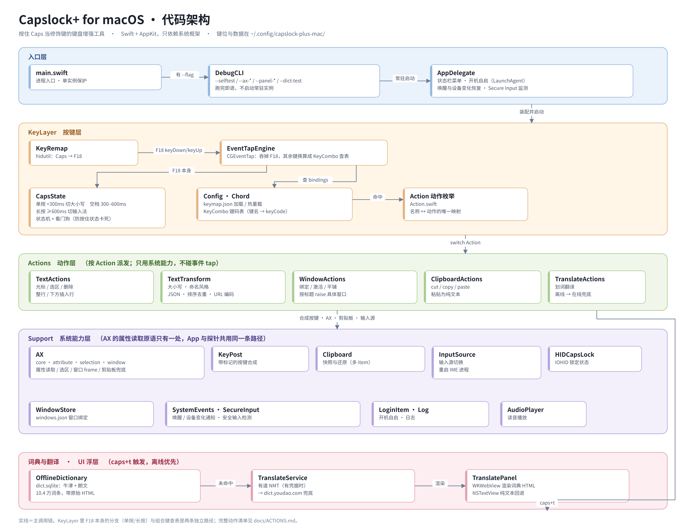

# Capslock+ for macOS

把 Caps Lock 变成「按住当修饰键」的键盘增强工具，逻辑照搬 Windows 上的 Capslock+ / AutoHotkey 版，
用 Swift + AppKit 重写，只依赖系统框架。

## 用途

按住 **Caps** 不放，它就是一个修饰键：配合字母/数字在**主键区**完成文本编辑（移动光标、选中、删除、
移动整行）、窗口绑定与平铺、文本变换、插入日期时间、以及划词翻译。松开 Caps 恢复普通键盘。

- 单手不离开主键区就能改稿，不用去够方向键和鼠标
- `caps+t` 划词翻译：选中单词按一下，浮层里显示完整词条（本地牛津/朗文 + 在线兜底），带读音
- `caps+alt+数字` 把当前窗口绑到某个数字上，之后 `caps+数字` 直接跳回去

不做的部分（v0 明确砍掉）：启动器/qbar、按 App 切换键位方案、多剪贴板、自动更新、偏好设置界面。

## 使用方式

### 1. 装好并授权（只需一次）

```bash
ditto dist/CapslockPlusMac.app /Applications/CapslockPlusMac.app
open /Applications/CapslockPlusMac.app
```

首次运行后在「系统设置 → 隐私与安全性」里给 **辅助功能** 和 **输入监控** 打勾，然后重启 app。
两个权限缺一不可：辅助功能用于读写焦点窗口/选区，输入监控用于抓按键。

菜单栏出现图标即是常驻成功。菜单里「开机自启」可开关。

### 2. 键位

按住 **Caps** 当修饰键（`alt` = Mac 的 **Option ⌥**）。下表是本机 `keymap.json` 的实际绑定：

```
光标    s 左   f 右   e 上   d 下        a 左一词   g 右一词   shift+t 上10行  b 下10行
选区    j 左   l 右   i 上   k 下        h 左选一词  y 上10行   n 下10行
        u 选到行首   o 选到行尾   , 当前词   . 右选一词
行      p 行首   ; 行尾
删除    w 删前一字符   r 删后一字符   [ 删到行首   / 删到行尾
        backspace 删整行   enter 下方插入空行   space 回车
翻译    t 划词翻译
日期    q 插入日期      shift+q 插入日期时间
变换    shift+u 大写  shift+l 小写  shift+c 驼峰  shift+p 帕斯卡  shift+n 下划线
        shift+k 中划线  shift+x 常量  shift+z 去首尾空白  x 中英标点互转
        shift+j JSON 美化  shift+r 排序  shift+d 去重  shift+e URL 编码
窗口    alt+1..0 绑定当前窗口     1..0 激活已绑定的窗口（绑定落盘，重启仍有效）
        ctrl+h 左半屏  ctrl+l 右半屏  ctrl+k 上半屏  ctrl+j 下半屏
        ctrl+return 最大化  ctrl+c 居中
其他    f5 重载键位表   alt+r 修复输入法（卡英文时用）   esc / ` / tab 直接吞掉
单按 Caps = 切换大小写
长按 Caps 0.6 秒 = 切换输入法（到 0.6s 当场触发一次，之后仍可按着继续用组合键）
```

动作名与参数化写法（`moveUp(20)`、`send(cmd+shift+t)`、`wrapSelection(paren)` 等）见
[`docs/ACTIONS.md`](docs/ACTIONS.md)。

时间档位（`chordMaxMs` / `longPressMs` 可调，clamp 300–3000ms）：

```
< 300ms    切大小写
300–600ms  空档（按着犹豫，什么都不做）
≥ 600ms    切输入法
```

### 3. 改键位

键位表在 `~/.config/capslock-plus-mac/keymap.json`，改完按 **caps+F5** 生效，不用重新编译。

### 4. 划词翻译

选中一个单词 → `caps+t` → 浮层显示词条。浮层里可以继续划选别的词再按 `caps+t` 换词，
🔊 播放读音。

- 默认**不自动关闭**，点外部也不关；再按 `caps+t`（浮层内无选区时）、点 ✕ 或按 `Esc` 关闭
- 想恢复自动关闭：`keymap.json` 顶层加 `"panelAutoHideMs": 12000`（毫秒，0 = 不自动关）
- 词条默认用 WKWebView 渲染词典原始 HTML（颜色、表格、插图、音标字体都保留）；
  想退回纯文本加 `"panelRenderMode": "text"`

## 注意事项

- **Secure Input 期间所有热键失效**（密码框、`sudo` 提示、1Password 等）。这是系统行为，第三方
  event tap 收不到任何按键。菜单栏图标会变成锁，tooltip 标出是哪个 App 开启的；
  关闭密码框后自动恢复。实测整个 sudo 密码提示期间 0 条按键事件。
- **`kill -9` 之后 Caps 会变成死键**（映射撤不掉）。`./scripts/keyremap.sh off` 撤掉映射，
  `./scripts/keyremap.sh status` 看当前状态。正常退出、SIGTERM/SIGINT、睡眠唤醒、键盘热插拔都会自动处理。
- **窗口绑定只能到「应用级 + 标题提示」**：macOS 没有跨进程稳定的窗口标识。跳转时先按标题 raise 具体窗口，
  标题变了（Terminal 换了命令、浏览器换了页）就只切到该 app，日志记 `title-miss`。
- **绑定的 app 没在运行时会自动启动它**，从启动到窗口可用有 1–2 秒延迟。
- **带修饰键的 chord 里合成 `Cmd+C` 无效**（多剪贴板没实现），所以用这类动作时「复制」拿不到内容；
  无修饰的方向键类动作不受影响。
- **剪贴板兜底会有副作用**：AX 读不到选区的 App（Excel、Inkscape 等白名单）靠「备份剪贴板 → 模拟 Cmd+C →
  读 → 还原」取词，Clipy 这类历史工具会记录这一次复制。
- **JVM 系 App 要在 IDE 内勾 "Support screen readers"** 才暴露文本节点；Qt / GPU 终端 / 远程桌面
  拿不到 AX 选区，只能走白名单兜底。
- **词典与读音是本地数据，不在仓库里**（`dict.sqlite` 459MB、`audio/` 505MB、`dict-assets/` 181MB），
  放在 `~/.config/capslock-plus-mac/`。翻译凭据同理（`youdao.json`，mode 600），没配也能用公开接口。
- 日志在 `~/Library/Logs/CapslockPlusMac.log`，菜单栏 → 「打开日志」。

## 代码架构



分层职责：

- **入口层** `main.swift` / `DebugCLI`：单实例保护、命令行子命令（自检与探针），子命令跑完直接退出，
  不影响常驻实例
- **按键层** `KeyLayer/`：hidutil 把 Caps 重映射成 F18 → CGEventTap 吞掉 F18 自己维护「按住/松开」
  → `CapsState` 判定单按（切大小写）/ 空档 / 长按（切输入法）→ 其余按键经 `Chord` 的键码表换算成
  `KeyCombo` 去查 `Config.keymap.bindings` 得到 `Action`
- **动作层** `Actions/`：只用 `Support` 提供的系统能力（合成按键、AX、剪贴板）实现语义动作，
  不直接碰事件 tap
- **系统能力层** `Support/`：AX 的读取原语收敛在 `AXAttribute.swift` 一处，App 与探针共用同一条路径；
  输入源、HID、窗口存储、日志都在这里
- **配置层** `Action.swift` / `Config.swift`：动作名 ↔ `Action` 的唯一映射表 + 键位表读写/默认值
- **UI 层** `UI/TranslatePanel`：翻译浮层，HTML（WKWebView）与纯文本（NSTextView）两种渲染模式
