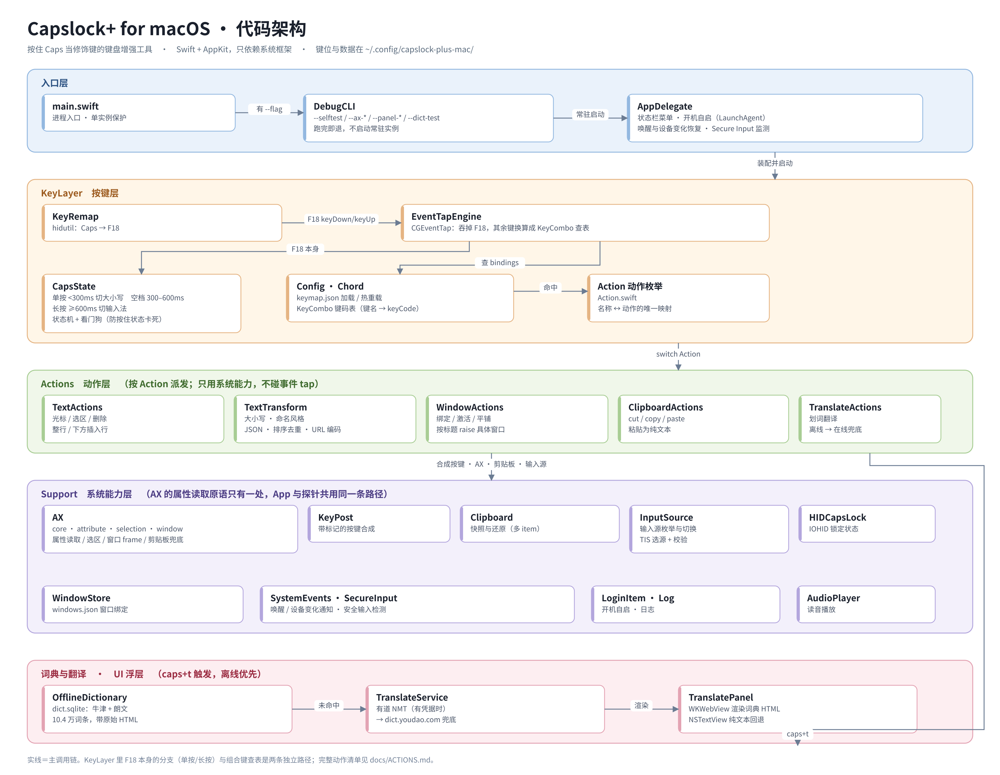

# Capslock+ for macOS

把 Caps Lock 变成「按住当修饰键」的键盘增强工具，逻辑照搬 Windows 上的 Capslock+ / AutoHotkey 版，
用 Swift + AppKit 重写，运行时只依赖系统框架（菜单里的「录屏转 GIF」另需 ffmpeg，见下）。

## 用途

按住 **Caps** 不放，它就是一个修饰键：配合字母/数字在**主键区**完成文本编辑（移动光标、选中、删除、
移动整行）、窗口绑定与平铺、文本变换、插入日期时间、以及划词翻译。松开 Caps 恢复普通键盘。

- 单手不离开主键区就能改稿，不用去够方向键和鼠标
- `caps+t` 划词翻译：选中单词按一下，浮层里显示完整词条（本地牛津/朗文 + 在线兜底），带读音
- `caps+alt+数字` 把当前窗口绑到某个数字上，之后 `caps+数字` 直接跳回去

不做的部分（v0 明确砍掉）：启动器/qbar、按 App 切换键位方案、多剪贴板、自动更新、偏好设置界面。

## 使用方式

### 1. 装好并授权（只需一次）

```bash
ditto dist/CapslockPlusMac.app /Applications/CapslockPlusMac.app
open /Applications/CapslockPlusMac.app
```

首次运行后在「系统设置 → 隐私与安全性」里给 **辅助功能** 和 **输入监控** 打勾，然后重启 app。
两个权限缺一不可：辅助功能用于读写焦点窗口/选区，输入监控用于抓按键。

菜单栏出现图标即是常驻成功。菜单里「开机自启」可开关。

### 2. 键位

按住 **Caps** 当修饰键（`alt` = Mac 的 **Option ⌥**）。下表是本机 `keymap.json` 的实际绑定：

```
光标    s 左   f 右   e 上   d 下        a 左一词   g 右一词   shift+t 上10行  b 下10行
选区    j 左   l 右   i 上   k 下        h 左选一词  y 上10行   n 下10行
        u 选到行首   o 选到行尾   , 当前词   . 右选一词
行      p 行首   ; 行尾
删除    w 删前一字符   r 删后一字符   [ 删到行首   / 删到行尾
        backspace 删整行   enter 下方插入空行   space 回车
翻译    t 划词翻译
日期    q 插入日期      shift+q 插入日期时间
变换    shift+u 大写  shift+l 小写  shift+c 驼峰  shift+p 帕斯卡  shift+n 下划线
        shift+k 中划线  shift+x 常量  shift+z 去首尾空白  x 中英标点互转
        shift+j JSON 美化  shift+r 排序  shift+d 去重  shift+e URL 编码
窗口    alt+1..0 绑定当前窗口     1..0 激活已绑定的窗口（绑定落盘，重启仍有效）
        ctrl+h 左半屏  ctrl+l 右半屏  ctrl+k 上半屏  ctrl+j 下半屏
        ctrl+return 最大化  ctrl+c 居中
其他    f5 重载键位表   esc / ` / tab 直接吞掉
单按 Caps = 切换大小写
长按 Caps 0.6 秒 = 切换输入法（到 0.6s 当场触发一次，之后仍可按着继续用组合键）
           切换成功后屏幕正中会短暂显示切换到的输入法名字；`keymap.json` 里 `imeToastMs`
           可调停留毫秒（默认 700，0 = 不显示）
```

动作名与参数化写法（`moveUp(20)`、`send(cmd+shift+t)`、`wrapSelection(paren)` 等）见
[`docs/ACTIONS.md`](docs/ACTIONS.md)。

时间档位（`chordMaxMs` / `longPressMs` 可调，clamp 300–3000ms）：

```
< 300ms    切大小写
300–600ms  空档（按着犹豫，什么都不做）
≥ 600ms    切输入法
```

### 3. 改键位

键位表在 `~/.config/capslock-plus-mac/keymap.json`，改完按 **caps+F5** 生效，不用重新编译。

### 4. 划词翻译

选中一个单词 → `caps+t` → 浮层显示词条。浮层里可以继续划选别的词再按 `caps+t` 换词，
🔊 播放读音。

- 默认**不自动关闭**，点外部也不关；再按 `caps+t`（浮层内无选区时）、点 ✕ 或按 `Esc` 关闭
- 想恢复自动关闭：`keymap.json` 顶层加 `"panelAutoHideMs": 12000`（毫秒，0 = 不自动关）
- 词条默认用 WKWebView 渲染词典原始 HTML（颜色、表格、插图、音标字体都保留）；
  想退回纯文本加 `"panelRenderMode": "text"`

### 5. 小工具：录屏转 GIF

菜单栏图标 → **小工具 → 录屏转 GIF…**

1. 点之前会先查环境：缺 ffmpeg（必需）会弹窗并给出一条可复制的 `brew install ffmpeg`；
   缺 gifsicle（可选）会问一次——选「复制安装命令」就复制好命令并退出，装完再点一次菜单；
   选「不装，直接转换」就跳过优化继续转（同一次运行里不再问）
2. 弹出文件选择框，可以多选 `.mov` / `.mp4`
3. 双击（或点「转换」）后直接在**原文件夹**生成同名 GIF。转换在后台进行，**菜单栏图标会变成进度条**
   （知道时长就按百分比填，拿不到就滑动动画），转完右上角弹 1 秒「已转换 N 个」，自动消失
4. 同名文件不覆盖：已存在 `demo.gif` 时依次生成 `demo-2.gif`、`demo-3.gif`

转换参数固定为：宽度缩到 800px（原本更窄就保持原样）、12fps、两遍调色板（界面纯色区域不起色带）。
装了 `gifsicle` 会再压一道：界面类录屏（大面积静止）通常再小 20~40%，动作多的视频只有几个百分点
（实测同一段满屏噪点素材：1,279,777 → 1,233,365 字节，仅 -3.6%）。命令行等价用法：
`./scripts/make-gif.sh in.mov out.gif --width 800 --fps 12`。

### 6. 活动监视器

菜单栏显示四组紧凑读数（标签在上、数值在下）：

```
   CPU   内存   下载   上传
   16%    35%   4.0M    46K
```

网络只统计**物理网卡**（en*）—— 开 VPN 时同一份字节会同时记在 utun 和 en0 上，
全加起来会翻倍，所以隧道单独统计（非零时 tooltip 里会带一行）。走热点时 CPU 标签前会出现橙色 wifi 小图标。

点菜单里的 **活动监视器…** 打开窗口：

```
上半屏   CPU / 内存 进度条，一行摘要：负载 · 温度 · 风扇 · 电池
         一行网卡明细：en0 Wi-Fi★ ↓1.2M ↑46K   utun3 ↓0 ↑0 …
         （★ = 默认路由所在网卡；名字来自 networksetup -listallhardwareports，
           en2 会显示成「雷雳2」、en5 显示成「以太网」；只列有 IP 或有流量的口，
           悬停可以看全部网卡及未启用状态）
下半屏   进程表：进程名 · CPU · 内存 · 端口 · PID
         点表头按任意列排序（默认 CPU 降序），CPU >10% 标橙、>50% 标红
         「端口」列显示该进程正在监听的 TCP 端口（蓝色，多于两个显示 +N，悬停看全部）
         行尾 ⓘ 打开进程详情：启动时间/已运行时长、可执行文件路径、启动参数、工作目录、
         父进程、用户、状态、线程数、常驻与物理内存、累计 CPU、监听端口、Bundle ID
         （详情面板里可选中复制，也能「在 Finder 中显示」；root 采样开着时 root 进程也读得到）
         选中行在多轮刷新之间保持（按 PID 定位，不随排序跳动）
```

采样全部走系统框架，不读 Stats 的数据，也不依赖它：

```
CPU 总占用   mach host_statistics(HOST_CPU_LOAD_INFO)
内存        mach host_statistics64(HOST_VM_INFO64)
进程 CPU    libproc proc_pid_rusage(RUSAGE_INFO_V4)，时间单位是 mach tick（需按 timebase 换算）
进程内存    rusage ri_phys_footprint（与活动监视器"内存"列同口径）
进程列表    libproc proc_listpids(PROC_ALL_PIDS)
监听端口    libproc PROC_PIDLISTFDS + PROC_PIDFDSOCKETINFO（只取 TCP、state=LISTEN，IPv4/IPv6 去重）
温度/风扇   IOKit AppleSMC（只读）
网络分卡    libc getifaddrs + if_data，按名字分类：en*=物理 / utun*=隧道 / bridge*=虚拟 /
           ap*=热点 / awdl*=直连；物理口与隧道分开汇总，避免 VPN 下重复计数
电池        IOKit.ps + AppleSmartBattery
```

刷新节奏：进程与系统指标每 2 秒一次（全量约 17ms，在后台队列）；端口几乎不变，降频到每 8 秒扫一次，其余采样用缓存。

**要看系统进程的 CPU/内存**：点窗口左下的 **显示系统进程…**，系统弹一次授权框，通过后：

```
以 root 身份后台跑一个采样代理（就是本程序自己的 --root-agent 模式），
每 2 秒把全量进程数据写进临时目录，主程序读文件合并 —— 只弹一次密码
之后 WindowServer、launchd 这些系统进程的 CPU / 内存也能看到
再点一次变「停止 root 采样」；关掉窗口时代理会空转不采样，不白烧 CPU
代理随主程序退出，不留孤儿 root 进程
```

实现方式刻意避开 SMJobBless 特权 helper（那要 Developer ID + 公证 + 安装器）：
用 `osascript ... with administrator privileges`，系统自带的授权框，零安装。
想彻底停掉：`pkill -f -- '--root-agent'`（需要 root）。

**已知限制**：root 拥有的进程（WindowServer、系统守护进程等）读不到 CPU 与内存 ——
`proc_pid_rusage` / `PROC_PIDTASKINFO` 对它们返回 EPERM，`sysctl KERN_PROC_ALL` 在公开 SDK 里
RSS 字段是占位符、CPU 字段恒为 0。这类行会保留在表里（名字和端口照样能读），CPU/内存显示 `—`，
窗口底部注明有多少个 —— 点「显示系统进程…」用 root 读一次就能补上。活动监视器能显示是因为它带 `com.apple.system-task-ports` 这类 entitlement。

- 关掉菜单栏读数：`keymap.json` 顶层加 `"systemReadout": false`
- 改刷新间隔：`"systemSampleMs": 2000`（毫秒，夹在 500–10000；越小越费电）

## 注意事项

- **Secure Input 期间所有热键失效**（密码框、`sudo` 提示、1Password 等）。这是系统行为，第三方
  event tap 收不到任何按键。菜单栏图标会变成锁，tooltip 标出是哪个 App 开启的；
  关闭密码框后自动恢复。实测整个 sudo 密码提示期间 0 条按键事件。
- **`kill -9` 之后 Caps 会变成死键**（映射撤不掉）。`./scripts/keyremap.sh off` 撤掉映射，
  `./scripts/keyremap.sh status` 看当前状态。正常退出、SIGTERM/SIGINT、睡眠唤醒、键盘热插拔都会自动处理。
- **窗口绑定只能到「应用级 + 标题提示」**：macOS 没有跨进程稳定的窗口标识。跳转时先按标题 raise 具体窗口，
  标题变了（Terminal 换了命令、浏览器换了页）就只切到该 app，日志记 `title-miss`。
- **绑定的 app 没在运行时会自动启动它**，从启动到窗口可用有 1–2 秒延迟。
- **带修饰键的 chord 里合成 `Cmd+C` 拿不到内容**：物理按着的那几个修饰键会被合并进合成事件
  （实际发出去的是 Cmd+Option+C 之类），目标 App 不认。无修饰的方向键类动作不受影响；
  下一条的剪贴板兜底用的是同一套合成机制，所以只在"没有任何和弦修饰键被按住"时可靠。
- **剪贴板兜底会有副作用**：AX 读不到选区的 App（Excel、Inkscape 等白名单）靠「备份剪贴板 → 模拟 Cmd+C →
  读 → 还原」取词，Clipy 这类历史工具会记录这一次复制。
- **JVM 系 App 要在 IDE 内勾 "Support screen readers"** 才暴露文本节点；Qt / GPU 终端 / 远程桌面
  拿不到 AX 选区，只能走白名单兜底。
- **词典与读音是本地数据，不在仓库里**（`dict.sqlite` 459MB、`audio/` 505MB、`dict-assets/` 182MB），
  放在 `~/.config/capslock-plus-mac/`。翻译凭据同理（`youdao.json`，mode 600），没配也能用公开接口。
- **偶发「某个 App 里输入法不出候选框」**：全局输入源正确、其它 App 同时正常，只有那一个 App
  不弹候选（实测是 Terminal）。**解法：切到别的 App 打两个字再切回来**（让那个 App 重建输入上下文）。
  已排除切源失败、IME 进程卡英文、杀进程、短间隔连切；确定是该 App 的输入上下文与输入法客户端
  脱钩，但触发条件没定位。自动修复做过两版（重启 IME 进程、重建输入上下文），实测都没用，
  已从菜单和键位里移除。
- **「录屏转 GIF」需要 ffmpeg**（`brew install ffmpeg`）。GUI 进程由 LaunchAgent 拉起，`PATH` 只有
  `/usr/bin:/bin:/usr/sbin:/sbin`，所以程序会自己去 `/opt/homebrew/bin` 找，不依赖你的 shell 环境。
- 日志在 `~/Library/Logs/CapslockPlusMac.log`，菜单栏 → 「打开日志」。

## 代码架构



分层职责：

- **入口层** `main.swift` / `DebugCLI`：单实例保护、命令行子命令（自检与探针），子命令跑完直接退出，
  不影响常驻实例
- **按键层** `KeyLayer/`：hidutil 把 Caps 重映射成 F18 → CGEventTap 吞掉 F18 自己维护「按住/松开」
  → `CapsState` 判定单按（切大小写）/ 空档 / 长按（切输入法）→ 其余按键经 `Chord` 的键码表换算成
  `KeyCombo` 去查 `Config.keymap.bindings` 得到 `Action`
- **动作层** `Actions/`：只用 `Support` 提供的系统能力（合成按键、AX、剪贴板）实现语义动作，
  不直接碰事件 tap
- **系统能力层** `Support/`：AX 的读取原语收敛在 `AXAttribute.swift` 一处，App 与探针共用同一条路径；
  输入源、HID、窗口存储、日志都在这里
- **配置层** `Action.swift` / `Config.swift`：动作名 ↔ `Action` 的唯一映射表 + 键位表读写/默认值
- **UI 层** `UI/TranslatePanel`：翻译浮层，HTML（WKWebView）与纯文本（NSTextView）两种渲染模式
